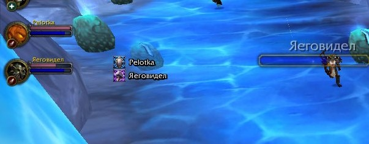

# PalAuraBars

Аддон для **World of Warcraft 3.3.5a (WotLK)** — показывает, **какая аура активна
у каждого паладина** в группе или рейде.

## Установка

1. Папку `PalAuraBars` помести в `<путь к WoW>\Interface\AddOns\`
2. Перезапустить клиент (или выполнить `/reload`).

## Команды

| Команда | Действие |
|---|---|
| `/pa` | открыть / закрыть окно настроек |
| `/pa unlock` | разблокировать позицию (перетаскивание мышью) |
| `/pa lock` | закрепить позицию |
| `/pa reset` | сбросить настройки |
